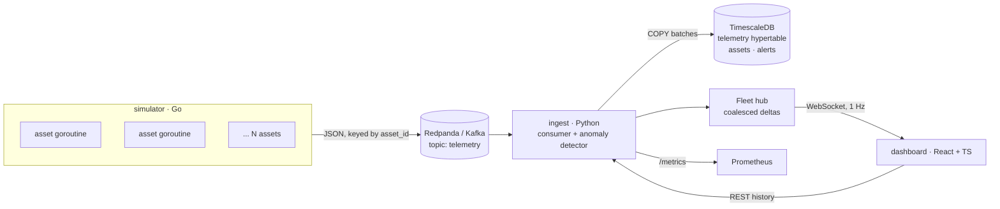

# Fleet Telemetry

A streaming platform for monitoring a large fleet of always-on assets — here, a simulated satellite constellation. Hundreds to thousands of devices publish telemetry independently; the platform ingests it through Kafka, detects anomalies in real time, persists it to a time-series database, and drives a live operator dashboard.


**Performance:** one ingest process sustains 20k msg/s (10k assets at 2 Hz) with p99 end-to-end latency of 0.8 s, and saturates at ~24k msg/s. It used to fall behind at ~15k. The load tests, py-spy profiles and fixes are in [PERFORMANCE.md](PERFORMANCE.md).

<!-- TODO: replace with a GIF of the dashboard -->

## Architecture



| Service | Stack | Responsibility |
|---|---|---|
| `simulator/` | Go, franz-go | One goroutine per asset on its own ticker. Orbital motion, battery/thermal model, injected faults (battery drain, overheat, comms loss). |
| `ingest/` | Python 3.12, aiokafka, asyncpg, FastAPI | Batch-consumes Kafka, validates, runs stateful anomaly detection, writes to Postgres, serves REST + WebSocket + Prometheus metrics. |
| `dashboard/` | React 18, TypeScript, Vite | Live constellation map, worst-first asset table, alert feed, per-asset history sparklines. |
| `db/` | TimescaleDB (Postgres 16) | `telemetry` hypertable with 1-day retention, `assets` latest-state table, `alerts`. |

## Quick start

Requires Docker.

```bash
docker compose up --build
```

- Dashboard: http://localhost:8080
- Ingest API: http://localhost:8000/docs
- Metrics: http://localhost:8000/metrics

Scale the fleet:

```bash
ASSET_COUNT=5000 INTERVAL_MS=500 docker compose up --build
```

### Local development

```bash
docker compose up redpanda postgres            # infrastructure only
cd simulator && go run .                       # publishes to localhost:19092
cd ingest && pip install -r requirements-dev.txt && uvicorn app.main:app --reload
cd dashboard && npm install && npm run dev     # http://localhost:5173, proxies to :8000
```

### Tests

```bash
cd simulator && go test -race ./...
cd ingest && pytest && ruff check .
cd dashboard && npm test
```

## Anomaly detection

| Alert | Trigger | Severity |
|---|---|---|
| `low_battery` | battery < 20% | warning; critical < 10% |
| `over_temp` | temp > 55 °C | warning; critical > 70 °C |
| `safe_mode` | asset reports `safe_mode` | critical |
| `seq_gap` | sequence number skips (dropped messages) | warning |
| `lost_contact` | no telemetry for 5× the expected interval, measured in stream time (see below) | critical |
| `restart` | sequence number resets with a newer timestamp (asset rebooted) | warning |

Threshold alerts are **edge-triggered**: they fire when a condition begins and re-arm only after it clears, so a single overheating asset produces one alert rather than one per message.

## Design decisions and tradeoffs

**Kafka between producers and storage.** Decouples device publish rate from database write rate. If Postgres slows or restarts, the consumer stops pulling and Kafka absorbs the backlog rather than the ingest process's memory.

**At-least-once delivery.** Offsets are committed only after a batch is durably written. A crash between write and commit replays the batch: the `assets` upsert ignores rows older than the stored timestamp, and the detector drops duplicate/reordered messages, so replays don't corrupt current state. Raw telemetry rows may duplicate on replay — acceptable for this use and cheaper than a dedupe index on a hot hypertable.

**Recency by timestamp, gaps by sequence.** Sequence numbers detect dropped messages, but they restart at 1 when an asset reboots. Latest-state comparisons therefore use the asset's timestamp; a lower sequence number paired with a newer timestamp is treated as a reboot (`restart` alert) and the gap detector re-baselines. Found by restarting the simulator mid-run: before the fix, every rebooted asset was silently discarded as a duplicate.

**Partition by asset ID.** Guarantees per-asset ordering, which the sequence-gap detector depends on, while still allowing the consumer group to scale horizontally across partitions.

**Batch writes via `COPY` and `unnest`.** The consumer pulls up to 5,000 records per poll and writes them in one transaction: raw rows with a single `COPY`, then the newest row per asset as one `UPDATE … FROM unnest(...)` statement (first-seen assets take an `INSERT … ON CONFLICT` path). Replacing a per-row `executemany` upsert with this made the latest-state write ~4× cheaper and raised single-consumer throughput from ~15k to ~24k msg/s — see [PERFORMANCE.md](PERFORMANCE.md).

**Staleness in stream time, not wall time.** `lost_contact` compares each asset against a watermark (newest event time processed, advanced by wall time between batches) rather than the wall clock. With the wall clock, a consumer that fell behind reported the entire fleet lost every few seconds — 4.3M false alerts in one load test — and writing those alerts deepened the backlog that caused them. Consumer lag is exported separately as `ingest_consumer_lag_seconds`.

**Coalesced WebSocket deltas.** The dashboard doesn't need every message. The hub keeps the latest state per asset and broadcasts one delta per second containing only changed assets, so browser cost scales with fleet size rather than message rate. Clients that fall behind are disconnected (bounded queue) and resync from a fresh snapshot on reconnect.

**Warm restart.** On startup the ingest service reloads latest asset state from Postgres so the dashboard isn't blank and the first message per asset isn't misread as a sequence gap.

**Fail loudly.** If any background task (consumer, stale checker, broadcaster) dies, the process exits so the orchestrator restarts it, rather than serving a silently stale dashboard.

## Roadmap

- [x] [`PERFORMANCE.md`](PERFORMANCE.md): load test at 1k / 5k / 10k assets, profile the consumer, document bottlenecks and fixes with before/after p99 end-to-end latency
- [ ] Scale ingest past one partition: more partitions + consumer replicas (needs a shared view for the WebSocket hub)
- [ ] Canvas-rendered map for 10k+ assets (SVG is the current ceiling)
- [ ] Kubernetes manifests (kind) with horizontally scaled ingest consumers
- [ ] Grafana dashboard provisioned from `/metrics`
- [ ] Operator commands back to assets (e.g. "exit safe mode") via a command topic
- [ ] Integration test running the full pipeline in CI with Testcontainers
